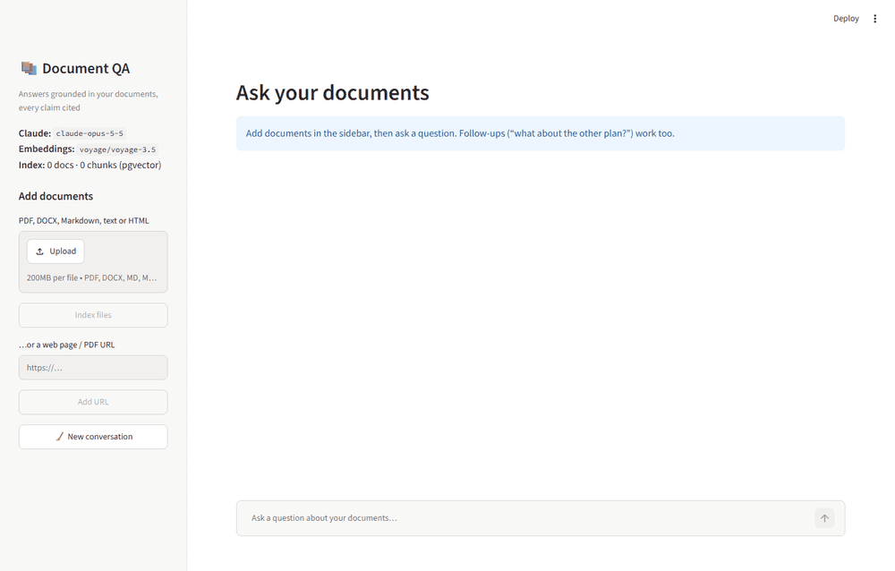
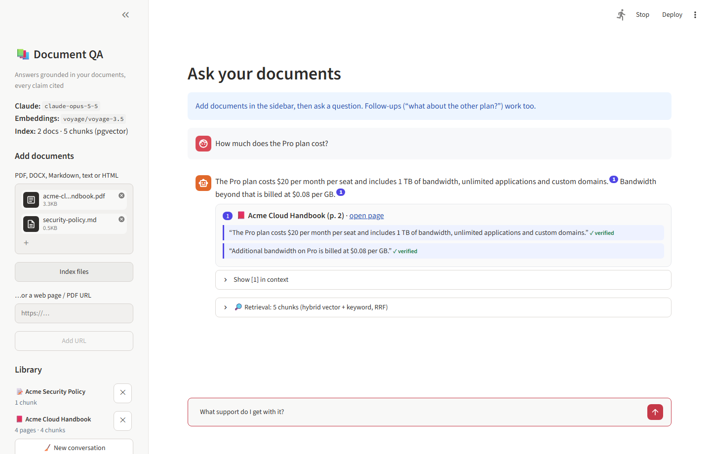
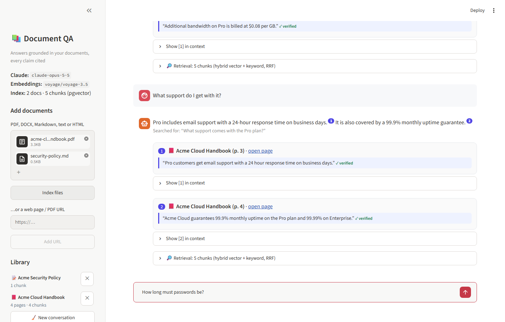
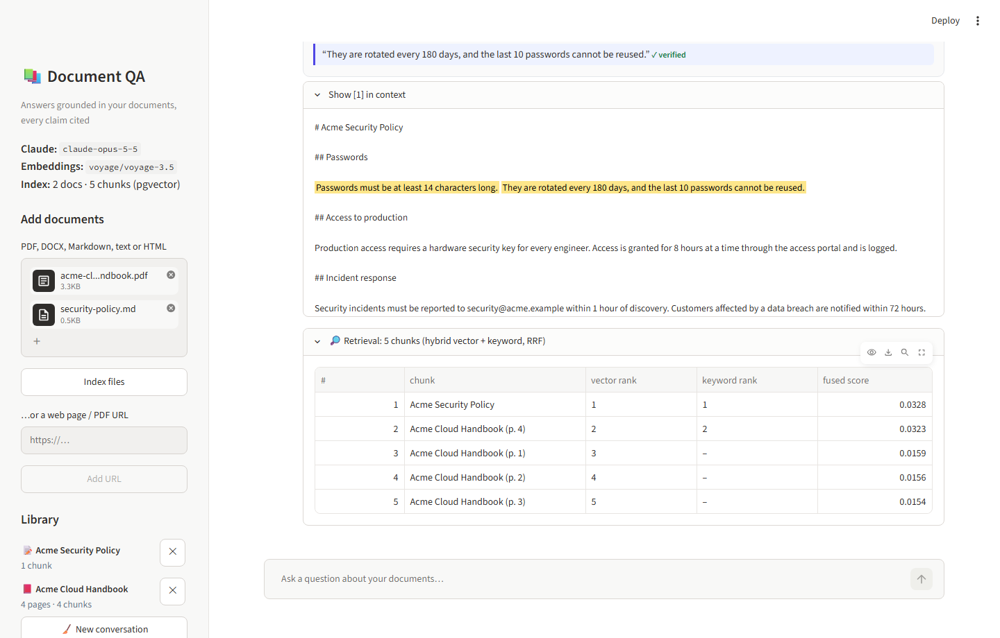
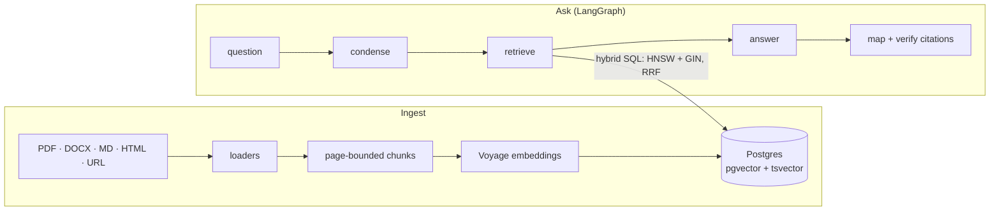

# Document QA with Citations

[](https://github.com/yordanossimegnew/document-qa-citations/actions/workflows/tests.yml)

Ask questions about your own documents (PDFs, Word files, Markdown, HTML, web pages) and get
answers where **every claim links to the exact quoted passage and page** it came from. If the
documents don't contain the answer, it says so instead of guessing.

Built with **LangGraph** and **LangChain**:
- Claude's native **Citations API** through `ChatAnthropic`, and **Voyage AI** embeddings through
  `langchain-voyageai`.
- **PostgreSQL + pgvector** for hybrid search, plus the LangGraph Postgres checkpointer for chat
  memory.
- A **FastAPI** API and a **Streamlit** UI.



<sub>Demo uses scripted model replies and a local stand-in for the embeddings; ingestion, PostgreSQL/pgvector retrieval, citation mapping and verification, and the UI are real.</sub>

| Cited answer | Follow-up question | Quote in context + retrieval ranks |
|---|---|---|
|  |  |  |

## Features

- **Ingest anything common:**
  - **PDF**, page by page.
  - **DOCX**, with headings and tables.
  - **Markdown** and plain **text**.
  - **HTML**, with navigation and scripts stripped.
  - **Web URLs**: pages or online PDFs. Redirects are followed manually and every hop goes
    through an SSRF check.
- **Page-precise citations:** chunks never cross a PDF page break, so every citation points at
  exactly one page. "Open page" jumps straight to it in the original PDF, which is stored in
  Postgres.
- **Claude Citations API:** each retrieved chunk is sent as a `document` block with
  `citations: {enabled: true}`. Claude returns its answer as text spans, each tied to a
  document and the exact `cited_text`.
- **Quote verification in code:** every quote is checked against its chunk, and the UI badges
  it ✓ verified or ⚠ not found.
- **Hybrid retrieval in one SQL query:**
  - **pgvector** cosine search (HNSW index) over Voyage `voyage-3.5` embeddings.
  - **Postgres full-text** search (GIN index, `ts_rank_cd`).
  - **Reciprocal rank fusion** merges the two. Keyword search catches exact terms ("99.99%",
    product codes) that embeddings blur, and vectors catch paraphrases.
- **Conversations:** a LangGraph `condense` step rewrites follow-ups ("what support do I get
  with *it*?") into standalone questions before searching. History lives in the LangGraph
  Postgres checkpointer.
- **Honest when unsure:** if nothing relevant is retrieved, or the documents don't cover the
  question, it says so.
- **Transparent retrieval:** for every answer, the UI shows each chunk's vector rank, keyword
  rank and fused score.
- **Safe ingestion:** all-or-nothing transactions (no half-indexed documents), size limits, and
  page text treated as untrusted data.
- **CLI:** `python main.py add report.pdf` and `python main.py ask "..."`.

## Project structure

```
document-qa-citations/
├── README.md
├── requirements.txt
├── .env.example            # copy to .env (never commit .env)
├── .gitignore
├── Dockerfile
├── docker-compose.yml      # pgvector Postgres + API + UI
├── main.py                 # FastAPI app (`main:app`) + CLI (add / ask)
├── ui/
│   └── app.py              # Streamlit: library, chat, cited sources, retrieval details
├── docs/                   # demo.gif + screenshots
├── src/
│   ├── ingest/
│   │   ├── loaders.py      # PDF, DOCX, Markdown/text, HTML, URL (with SSRF guard)
│   │   ├── chunker.py      # page-bounded, heading-aware, overlapping chunks
│   │   └── pipeline.py     # load -> chunk -> embed -> store (one transaction)
│   ├── tools/
│   │   └── store.py        # Postgres + pgvector schema and the hybrid RRF search query
│   ├── agent/
│   │   ├── agent.py        # LangGraph: condense -> retrieve -> answer
│   │   ├── citations.py    # map citations to numbered sources, verify every quote
│   │   └── memory.py       # Postgres checkpointer (chat sessions)
│   ├── models/
│   │   └── llm_client.py   # VoyageAIEmbeddings + ChatAnthropic (document blocks, citations)
│   ├── prompts/            # condense + grounded answering prompts
│   ├── utils/              # config (env/.env), logging
│   └── api/                # FastAPI routes + Pydantic schemas
├── tests/                  # loaders, chunking, pgvector search, citations, graph, API
├── data/
│   └── samples/            # acme-cloud-handbook.pdf, security-policy.md to try it out
└── logs/
```

## Setup

```bash
cd document-qa-citations
python -m venv .venv
# Windows: .venv\Scripts\activate   |   macOS/Linux: source .venv/bin/activate
pip install -r requirements.txt
cp .env.example .env              # ANTHROPIC_API_KEY, VOYAGE_API_KEY, DATABASE_URL, TEST_DATABASE_URL
```

Create the databases once (pgvector must be available in your PostgreSQL):

```sql
CREATE DATABASE docqa;
CREATE DATABASE docqa_test;        -- used only by pytest
\c docqa
CREATE EXTENSION vector;           -- and the same in docqa_test
```

Tables, indexes (HNSW + GIN) and checkpoint storage are created automatically on first start.

## Run it

```bash
uvicorn main:app --reload         # API  -> http://localhost:8000/docs
streamlit run ui/app.py           # UI   -> http://localhost:8501
```

Or from the terminal:

```bash
python main.py add data/samples/acme-cloud-handbook.pdf data/samples/security-policy.md
python main.py ask "How much does the Pro plan cost?"
```

## API

| Method | Path                      | Description                                                    |
|--------|---------------------------|----------------------------------------------------------------|
| POST   | `/documents`              | Upload files (multipart) → indexed documents                   |
| POST   | `/documents/url`          | `{"url": "..."}`: fetch a page or PDF and index it             |
| GET    | `/documents`              | The library                                                    |
| GET    | `/documents/{id}`         | Document details + its chunks with page ranges                 |
| GET    | `/documents/{id}/file`    | The original file (PDF links use `#page=N`)                    |
| DELETE | `/documents/{id}`         | Remove a document and its chunks                               |
| POST   | `/ask`                    | `{"question": "...", "session_id": null, "document_ids": null}` |
| GET    | `/search?q=...`           | Retrieval only: vector rank, keyword rank, fused score         |
| GET    | `/sessions/{id}`          | Conversation history                                           |

A response from `/ask` (trimmed):

```json
{
  "markdown": "The Pro plan costs $20 per month per seat ...[1] Bandwidth beyond that is billed at $0.08 per GB.[1]",
  "sources": [{
    "n": 1, "label": "Acme Cloud Handbook (p. 2)", "page_start": 2, "document_id": "3f9c…",
    "quotes": [{"text": "The Pro plan costs $20 per month per seat and includes 1 TB of bandwidth, …", "verified": true}]
  }],
  "all_quotes_verified": true,
  "retrieved": [{"label": "Acme Cloud Handbook (p. 2)", "vector_rank": 1, "keyword_rank": 1, "score": 0.0328}]
}
```

## Tests

```bash
pytest -q        # uses TEST_DATABASE_URL (a dedicated Postgres + pgvector test database)
```

The tests generate real PDF and DOCX files, index them into pgvector, and run hybrid search. The
QA graph runs with a scripted model that returns real citation blocks, covering follow-ups,
page precision, quote verification and the "not found" path. No API keys needed.

## Configuration

| Variable          | Default            | Meaning                                              |
|-------------------|--------------------|------------------------------------------------------|
| `DATABASE_URL`    | *(required)*       | PostgreSQL with pgvector                             |
| `VOYAGE_MODEL`    | `voyage-3.5`       | Embedding model (`EMBEDDING_DIM` must match: 1024)   |
| `AGENT_MODEL`     | `claude-opus-5-5`  | Claude model                                         |
| `AGENT_EFFORT`    | `medium`           | Thinking depth                                       |
| `CHUNK_CHARS`     | `2400`             | Max characters per chunk (~600 tokens)               |
| `CHUNK_OVERLAP`   | `300`              | Characters carried into the next chunk               |
| `TOP_K`           | `8`                | Chunks sent to Claude per question                   |
| `MAX_UPLOAD_MB`   | `25`               | Upload / download size limit                         |

## How it works



1. **Ingest:** each file becomes sections with page numbers or headings. Sections are chunked
   with overlap but never across a page break, then embedded (`input_type="document"`) and
   stored with a generated `tsvector` column, all in one transaction.
2. **Condense:** on a follow-up, Claude rewrites the question using the chat history (structured
   output, JSON schema).
3. **Retrieve:** one SQL query ranks chunks by vector distance and by full-text relevance,
   then fuses the two rankings: `score = 1/(60 + vector_rank) + 1/(60 + keyword_rank)`.
4. **Answer:** the top chunks go to Claude as citable documents. Its cited spans are mapped back
   to `{document, page, quote}`, numbered, and each quote is verified against the stored
   chunk text.

## Ideas to extend

- Rerank the top 30 chunks with a cross-encoder (e.g. Voyage rerank) before answering.
- OCR for scanned PDFs.
- Per-user collections with row-level security in Postgres.
